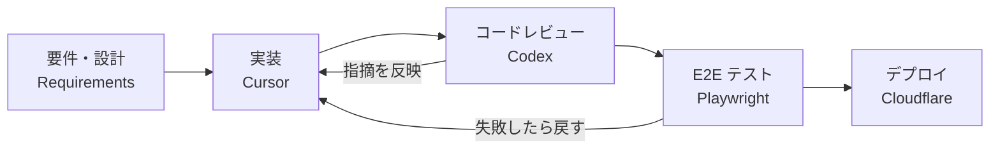

<!-- Header -->

  

  

  
  
  

---

## About Me

**岩田 穂治（Hoharu Iwata）** です。日本で Web エンジニアをしています（経験 約3年）。

- PHP（素の PHP + Smarty / Laravel）から TypeScript（Vue / React）まで、サーバーサイドもフロントも書きます
- MySQL・PostgreSQL・DynamoDB を扱い、kintone のカスタマイズやシェル / PHP のバッチ処理も担当
- 職場では GitHub Copilot を使った **AI 駆動開発の導入をリード**
- 個人では要件定義からデプロイまで一人で回し、リリース後も改善を続けるのが好きです

> *A Japan-based web engineer who designs, builds, and ships full-stack apps with an AI-assisted workflow.*

---

## How I Build — AI-Driven Workflow

実装は **Cursor**、コードレビューは **Codex**、品質の最後の砦は **Playwright の E2E テスト**。
AI に書かせて、別の AI に見てもらい、テストで確かめる。この流れを個人開発でも回しています。

  
  
  
  

---

## Tech Stack

**Languages**

  

**Frontend / Backend**

  
  
  

**Database / ORM**

  
  
  

**Cloud / Tools**

  
  

---

## Featured Works

<table>
  <tr>
    <td width="50%" valign="top">
      <h3>NAP — 人材派遣業向け業務システム</h3>
      
派遣業務の <b>シフト管理・勤怠・見積・請求書</b> をひとつにまとめた Web システム。要件定義から設計・実装・テスト・デプロイまで一人で担当し、現在も機能追加を継続中（副業・非公開）。

      

        
        
        
        
        
        
      

    </td>
    <td width="50%" valign="top">
      <h3>Tokyo Side Trips</h3>
      
訪日旅行者向けの英語トラベルガイド。鎌倉・江ノ島・箱根・横浜など、東京からの日帰り／一泊旅行を紹介しています。サイトの運営は <b>AI エージェントと一緒に回している</b> プロジェクト。

      

        
        
      

    </td>
  </tr>
  <tr>
    <td width="50%" valign="top">
      <h3>pet-post</h3>
      
ペットの写真を毎日交換し合うアプリ。Cloudflare Workers 上で動かしています（非公開）。

      

        
        
      

    </td>
    <td width="50%" valign="top">
      <h3>smart-mock</h3>
      
OpenAPI・TypeScript・JSON スキーマから立ち上がる、コンテキストを考慮したローカル Mock API サーバー。Rust 製。

      

        
        
      

    </td>
  </tr>
</table>

---

## Activity

  

---

<!-- Footer -->

  

